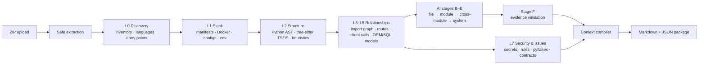

# ContextForge

**AI-powered codebase intelligence and universal LLM context generation.**

Upload a ZIP of any software project. ContextForge extracts it safely, maps its structure, stack, APIs, data model,
dependency graph, workflows and risks, then compiles a source-referenced Markdown knowledge base that any LLM can use to
debug, extend, review or refactor the project — without access to the original code.

> Deterministic extraction + structural code intelligence + AI semantic understanding = reliable project context.
> Facts that can be extracted from code are never left to a model, and every model statement carries validated `file:line` references.

---

## Contents

- [What you get](#what-you-get)
- [How it works](#how-it-works)
- [Quick start](#quick-start)
- [Configuration](#configuration)
- [Supported languages, frameworks and providers](#supported-languages-frameworks-and-providers)
- [Security model](#security-model)
- [Testing](#testing)
- [Project structure](#project-structure)
- [Known limitations](#known-limitations)
- [Documentation](#documentation)

## What you get

For every analysis, a downloadable **context package**:

```text
contextforge-<project>/
├── CONTEXTFORGE_PROJECT_CONTEXT.md   # master knowledge base: 32 sections, self-contained
├── 00_PROJECT_OVERVIEW.md … 19_FILE_INDEX.md   # 20 focused documents
├── layers/                           # one document per analysis layer (23)
│   ├── TECH_STACK.md, DEPENDENCIES.md, CONFIGURATION.md
│   ├── CODEBASE_MAP.md, MODULE_REFERENCE.md, FUNCTION_REFERENCE.md
│   ├── ARCHITECTURE.md, SYSTEM_DESIGN.md, COMPONENT_RELATIONSHIPS.md
│   ├── API_REFERENCE.md, DATA_FLOW.md, INTEGRATION_MAP.md
│   ├── DATABASE_SCHEMA.md, DATABASE_RELATIONSHIPS.md, DATABASE_OPERATIONS.md
│   ├── BUSINESS_LOGIC.md, APPLICATION_WORKFLOWS.md, CORE_FUNCTIONALITY.md
│   └── SECURITY_REVIEW.md, RELIABILITY_REVIEW.md, POTENTIAL_ISSUES.md, BUG_ANALYSIS.md
├── data/
│   ├── PROJECT_METADATA.json      # fingerprint, versions, provider/model, counts, output validation
│   ├── ANALYSIS_MANIFEST.json     # every file: analysed / deterministic_only / skipped / excluded / failed + reason
│   ├── DEPENDENCY_GRAPH.json      # file + module import graph, external packages, cycles
│   ├── repository_overview.json, file_inventory.json, PROJECT_FACTS.json
└── README.md                      # how to use the package with an LLM
```

The master document covers: overview, purpose, executive summary, tech stack, repository structure, architecture,
modules, file reference, key symbols, entry points, API documentation (with static call traces into services and
database operations), database schema + ER diagram, relationships, data flow, auth, integrations, business logic,
workflows, environment configuration, build/run instructions, testing, security, reliability, dependencies, potential
bugs, technical debt, known limitations, missing information, architectural decisions, debugging entry points, a full
file index and open questions. Sections that do not apply say so and why.

Every statement is labelled: `DETECTED` (extracted from source), `INFERRED` (derived from relationships/conventions),
`AI_INTERPRETED` (model explanation with validated references) or `UNKNOWN` (insufficient evidence).
See [`docs/examples/`](docs/examples/) for a real generated master document.

The **web app** adds a workspace dashboard, upload with live stage-by-stage progress (Server-Sent Events), a project
intelligence dashboard, a context explorer (search, table of contents, Mermaid diagrams, copy/download), an interactive
architecture explorer (modules, file dependencies, API ↔ frontend calls, database ER graph; React Flow), an issues
browser and a full analysis manifest. A CLI (`python -m app.cli analyze`) produces the same package without the UI.

## How it works



| Stage | What happens |
|---|---|
| Extraction | Path-traversal, symlink, ZIP-bomb, size/count/time limits; exclusions applied before anything touches disk. |
| Layer 0 | File inventory, language & category classification, LOC, binary detection, entry points, generated-code detection, directory tree. |
| Layer 1 | `package.json`, `requirements*.txt`, `pyproject.toml`, `Pipfile`, `setup.py`, `pom.xml`, `build.gradle(.kts)`, `Cargo.toml`, `go.mod`, `composer.json`, `Gemfile`, `pubspec.yaml`, Dockerfiles, compose files, deploy files, tsconfig/next/vite configs, `.env` templates. Detected vs inferred technologies are kept separate. |
| Layer 2 | Symbols, signatures, decorators, inheritance, imports/exports, calls, raises, env-var reads, HTTP client calls, SQL strings. |
| Layers 3–5 | Import resolution (Python packages, TS path aliases, Go modules, Java packages), dependency graph + cycle detection, router/blueprint/mount prefix resolution (including constants such as `settings.API_V1_STR` and FastAPI `Annotated` dependencies), client-call → route matching, ORM/Prisma/SQL models with fields, keys and relationships, DB operations, architecture layers. |
| Layer 7 | Secret scan (redacted), security & reliability rules, pyflakes, unresolved imports, unused deps, undocumented env vars, API contract mismatches, null-dereference heuristics, duplicate code, inconsistent types, an offline advisory table for well-known CVEs. |
| AI (B–E) | Token-budgeted, dependency-aware batches (related files grouped by module and import neighbourhood), hierarchical summarisation, bounded concurrency, retries with backoff and `Retry-After`, response caching, partial-failure recovery, cancellation. |
| Stage F | Every model reference is checked against the real inventory and line counts; invalid references are dropped, unknown paths flagged, claims without evidence marked unverified; AI-proposed issues without a verifiable location are discarded. |
| Compiler | 1 master + 20 modular + 23 layer documents + JSON; then completeness and reference-integrity validation. |

Deterministic results are written before the AI stages run and remain complete if the provider fails or is not configured.
Nothing is silently truncated: the manifest records why each file was or was not analysed.

## Quick start

### Docker (recommended)

```bash
cp .env.example .env
```

```bash
docker compose up --build
```

Open <http://localhost:3000>. API docs: <http://localhost:8000/docs>. Add an LLM key in **Settings** (or in `.env`).

### Local development

Requirements: Python ≥ 3.11 (3.13 tested), Node.js ≥ 20 (22 tested).

```bash
cd backend && python3 -m venv .venv && .venv/bin/pip install -r requirements-dev.txt
```

```bash
cd backend && .venv/bin/uvicorn app.main:app --reload --port 8000
```

```bash
cd frontend && npm ci && npm run dev
```

Or run both with `./scripts/dev.sh`.

### CLI (no UI)

```bash
cd backend && .venv/bin/python -m app.cli analyze /path/to/project --out ./context --provider none
```

```bash
cd backend && ANTHROPIC_API_KEY=... .venv/bin/python -m app.cli analyze project.zip --provider anthropic --depth standard
```

## Configuration

All backend settings use the `CONTEXTFORGE_` prefix (see [`.env.example`](.env.example) for the full list).

| Variable | Default | Purpose |
|---|---|---|
| `ANTHROPIC_API_KEY`, `OPENAI_API_KEY`, `GEMINI_API_KEY` | – | Provider keys (take precedence over keys saved in the UI). |
| `CUSTOM_LLM_BASE_URL`, `CUSTOM_LLM_API_KEY` | – | OpenAI-compatible endpoint. |
| `CONTEXTFORGE_DEFAULT_PROVIDER` / `_DEFAULT_MODEL` | `none` | Default provider when nothing is saved in Settings. |
| `CONTEXTFORGE_DATA_DIR` | `./data` | SQLite DB, encryption key, per-project outputs, caches. |
| `CONTEXTFORGE_SECRET_KEY` | generated | Fernet key for API keys stored via the UI. |
| `CONTEXTFORGE_API_TOKEN` | – | Optional shared secret required on `/api/*`. |
| `CONTEXTFORGE_ALLOW_PROVIDER_BASE_URL_OVERRIDE` | `false` | Allow custom base URLs for OpenAI/Anthropic/Gemini (a base URL receives the key). |
| `CONTEXTFORGE_CORS_ORIGINS` | `http://localhost:3000,…` | Allowed browser origins. |
| `CONTEXTFORGE_MAX_UPLOAD_MB` / `_MAX_EXTRACTED_MB` / `_MAX_FILE_COUNT` / `_MAX_SINGLE_FILE_MB` | 200 / 1024 / 50 000 / 50 | ZIP limits. |
| `CONTEXTFORGE_MAX_COMPRESSION_RATIO` / `_EXTRACTION_TIMEOUT_S` | 200 / 120 | ZIP-bomb ratio and extraction timeout. |
| `CONTEXTFORGE_DEFAULT_TOKEN_BUDGET` / `_MAX_CONCURRENT_AI_REQUESTS` | 400 000 / 4 | AI budget and concurrency defaults. |
| `CONTEXTFORGE_PUBLIC_API_URL` (frontend, runtime) | `http://localhost:8000` | URL the browser uses to reach the API. |

Per-analysis options (depth, provider, model) are chosen at upload; budgets, exclusions and privacy switches
(send source vs. structure only, response cache, keep archive) live in **Settings**.

## Supported languages, frameworks and providers

| Area | Coverage |
|---|---|
| Full AST | **Python** (stdlib `ast`), **JavaScript / TypeScript / JSX / TSX** (tree-sitter) |
| Schemas | **Prisma**, **SQL DDL** (`CREATE TABLE`, indexes, foreign keys) |
| Heuristic (labelled as such) | Go, Java, Kotlin, C#, Rust, PHP, Ruby, Swift, Dart, C, C++, Shell, Vue, Svelte |
| Inventory & classification | 80+ extensions incl. HTML, CSS/SCSS, YAML, JSON, TOML, Terraform, Dockerfile, GraphQL, Protobuf, notebooks |
| HTTP routes | FastAPI (routers, prefixes, `Annotated` deps), Flask (blueprints), Django `urls.py`, Express/Koa/Hono routers + mounts, NestJS controllers, Next.js route handlers & API routes, Spring, ASP.NET, Gin/Echo/Fiber/chi/net-http, Laravel/Slim, Rails/Sinatra, Actix/Rocket/Axum, GraphQL type defs, Socket.IO events |
| Client calls | `fetch`, axios (incl. instances), generated SDK request objects, API helper functions, `requests`/`httpx` |
| Data models | SQLAlchemy, SQLModel (incl. inherited fields), Django ORM, Prisma, TypeORM, Sequelize, Mongoose, JPA/Hibernate, GORM, ActiveRecord, SQL DDL |
| LLM providers | **Anthropic** (official SDK, streaming, default `claude-opus-5-5`, server-side refusal fallback), **OpenAI** (Chat Completions), **Google Gemini** (`generateContent`), **any OpenAI-compatible endpoint** (vLLM, Ollama, LM Studio, gateways). New providers register a factory in `backend/app/services/ai/providers/registry.py`. |

## Security model

- Uploaded archives are untrusted: no code, script, installer, migration or binary from them is ever executed.
- Extraction rejects absolute/`..` paths, never creates symlinks, enforces archive/entry/total size, file count,
  compression-ratio and time limits, rejects encrypted entries, and writes files non-executable (`0600`).
- XML manifests with DTDs/entities are refused (XXE); YAML uses `safe_load`.
- Secrets are detected (provider key formats, private keys, JWTs, credentials in URLs, high-entropy assignments) and
  **redacted** at parse time, again before any text is sent to an AI provider, and again on every generated file.
- API keys never reach the browser: environment variables or Fernet-encrypted SQLite storage, write-only API.
- Base-URL overrides for official providers are opt-in, so a settings change cannot redirect an operator's key.
- Optional shared-secret API token; CORS allow-list; security headers; compose binds to localhost; containers run as
  non-root, API read-only.
- Generated documents are path-validated on download (no traversal into other project files).

Details: [`docs/security/SECURITY.md`](docs/security/SECURITY.md).

## Testing

```bash
cd backend && .venv/bin/ruff check app tests && .venv/bin/mypy app && .venv/bin/pytest -q
```

```bash
cd frontend && npm run lint && npm run typecheck && npm test && npm run build
```

```bash
./scripts/e2e.sh
```

- **Backend (80 tests):** ZIP security, classification, manifests, parsers (Python/TS/heuristic/Prisma/SQL), import
  resolution, route prefixes, client matching, graph cycles, secret detection/redaction, security rules, token budgeting,
  chunking, evidence validation, orchestrator (full run, budget exhaustion, retries, permanent failure, cancellation,
  privacy mode, caching), provider adapters over real HTTP against protocol-faithful fake OpenAI and Anthropic (SSE)
  servers, Gemini via mocked transport, Markdown compilation & validation, the HTTP API end-to-end (deterministic and
  with an LLM endpoint), cancellation and the token gate. A live-provider test runs when
  `CONTEXTFORGE_LIVE_PROVIDER` and the matching key are set.
- **Frontend:** Vitest unit tests; Playwright end-to-end tests drive the real UI against a live backend and a fake
  OpenAI-compatible LLM (provider setup, connection test, upload, live progress, dashboard, explorer, search,
  architecture graph, issues, downloads).
- **Sample projects** in [`samples/`](samples/): Python + FastAPI shop, Next.js + TypeScript dashboard, full-stack
  React + Express + Prisma + PostgreSQL notes app — each with deliberate bugs and risks the analysis should surface.

## Project structure

```text
backend/
  app/
    api/            # FastAPI routers (projects, settings) and dependencies
    core/           # settings, logging (secret-scrubbing), crypto
    db/             # SQLite persistence (projects, events, settings)
    schemas/        # ProjectFacts data model (evidence classes, findings, graph…)
    services/
      extraction/   # hardened ZIP extraction
      scanning/     # Layer 0 inventory & classification
      dependency/   # Layer 1 manifests, stack knowledge base
      parsing/      # Layer 2 parsers (Python AST, tree-sitter, heuristics, Prisma, SQL) + cache
      architecture/ # Layers 3-5 import graph, routes, client matching, layers, traces
      security/     # Layer 7 secrets & security/reliability rules
      issues/       # bug & issue intelligence
      ai/           # provider abstraction, prompts, token budgeting, orchestrator, evidence validation
      context/      # Markdown compiler (sections, master/modular/layer docs, validation)
      export/       # package ZIP
      pipeline/     # runner (12 stages) and background job manager (SSE fan-out)
    cli.py, main.py
  tests/            # unit + integration (fake LLM servers)
frontend/
  app/              # Next.js App Router pages (workspace, new, settings, projects/[id]/…)
  components/       # UI primitives, layout, domain badges
  features/         # charts, markdown renderer, progress, claims, tree, project context
  hooks/ lib/ types/ e2e/
samples/            # three sample repositories
scripts/            # dev.sh, e2e.sh, make_sample_zips.py
docs/               # architecture, development, security, API, examples
```

## Known limitations

- Python and JS/TS get full AST analysis; other languages use regex heuristics (approximate symbol ranges, no types).
- Static analysis does not observe runtime behaviour: dynamic routes, DI containers, reflection and generated code at
  build time can be missed. Call traces resolve calls by name.
- The dependency vulnerability check uses a small offline advisory table and declared ranges, not lockfile resolution
  or a live vulnerability database.
- AI quality depends on the provider/model; all AI output is labelled and reference-validated but should be verified.
- Single-node, local-first deployment: SQLite and local disk; the optional API token is a shared secret, not user
  management. Put it behind an authenticating reverse proxy for multi-user use.
- Analyses interrupted by a server restart are marked failed (no resume).

## Documentation

- [Architecture](docs/architecture/ARCHITECTURE.md)
- [Development guide](docs/development/DEVELOPMENT.md)
- [Security](docs/security/SECURITY.md)
- [HTTP API](docs/API.md)
- [Contributing](CONTRIBUTING.md)

## License

[MIT](LICENSE)
