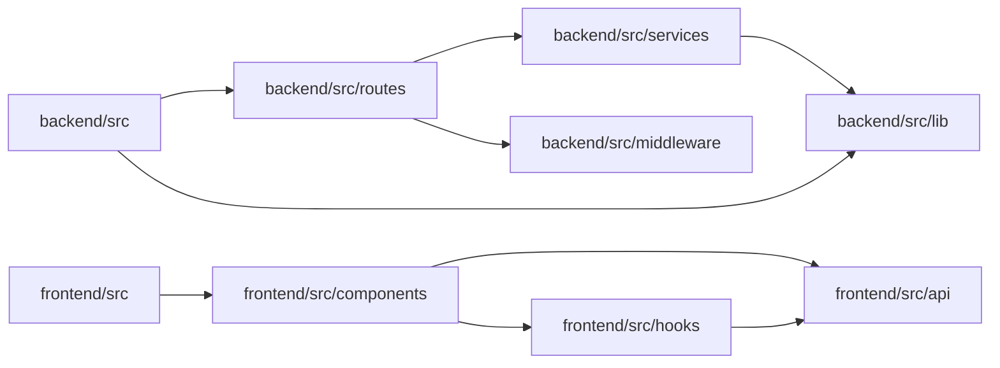
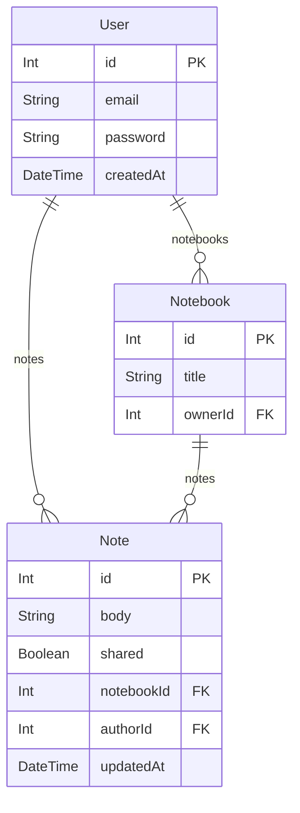

# Notes (sample) — Project Context

> **Project:** Notes (sample) · **Generated:** 2026-11-18T20:55:41+00:00 · **Fingerprint:** `e535515dfa64a7f5` · **ContextForge analysis version:** 1.0.0 · **AI provider/model:** none (deterministic only) · **Depth:** standard
>
> Evidence labels: `DETECTED` extracted directly from source · `INFERRED` derived from code relationships or conventions · `AI_INTERPRETED` explanation generated by a model (with validated source references) · `UNKNOWN` insufficient evidence.
> Source references use `path:line` or `path:start-end` relative to the repository root.


This document is a self-contained knowledge base about the repository, generated by ContextForge for use by humans and LLMs. It is structured technical knowledge (not a code dump): every important claim points to the source file and line it came from.

## Contents

1. [Project Overview](#1-project-overview)
2. [Project Purpose](#2-project-purpose)
3. [Executive Technical Summary](#3-executive-technical-summary)
4. [Technology Stack](#4-technology-stack)
5. [Repository Structure](#5-repository-structure)
6. [Architectural Overview](#6-architectural-overview)
7. [Module Descriptions](#7-module-descriptions)
8. [File-Level Reference Index](#8-file-level-reference-index)
9. [Important Functions and Classes](#9-important-functions-and-classes)
10. [Application Entry Points](#10-application-entry-points)
11. [API Documentation](#11-api-documentation)
12. [Database Architecture](#12-database-architecture)
13. [Database Relationships](#13-database-relationships)
14. [Data Flow](#14-data-flow)
15. [Authentication and Authorization](#15-authentication-and-authorization)
16. [External Integrations](#16-external-integrations)
17. [Business Logic](#17-business-logic)
18. [Core Application Workflows](#18-core-application-workflows)
19. [Environment Configuration](#19-environment-configuration)
20. [Build and Execution Instructions](#20-build-and-execution-instructions)
21. [Testing Architecture](#21-testing-architecture)
22. [Security Observations](#22-security-observations)
23. [Reliability Observations](#23-reliability-observations)
24. [Dependency Information](#24-dependency-information)
25. [Potential Bugs and Suspicious Code Patterns](#25-potential-bugs-and-suspicious-code-patterns)
26. [Technical Debt](#26-technical-debt)
27. [Known Limitations](#27-known-limitations)
28. [Missing Information](#28-missing-information)
29. [Important Architectural Decisions](#29-important-architectural-decisions)
30. [Suggested Debugging Entry Points](#30-suggested-debugging-entry-points)
31. [Comprehensive File Index](#31-comprehensive-file-index)
32. [Open Questions Requiring Developer Investigation](#32-open-questions-requiring-developer-investigation)

## 1. Project Overview

`DETECTED` **Notes (sample)** — 25 analysable files out of 25 in the archive (0 excluded), 14 source files, 0 test files, ~240 lines of code.
_Description provided at upload:_ Sample full-stack app shipped with ContextForge

**Languages**

| Language | Files | Code lines | Total lines |
| --- | --- | --- | --- |
| TypeScript | 15 | 184 | 222 |
| JSON | 3 | 38 | 38 |
| Prisma | 1 | 33 | 38 |
| YAML | 1 | 21 | 21 |
| SQL | 1 | 14 | 14 |
| Dockerfile | 1 | 7 | 7 |
| Env | 1 | 3 | 3 |
| Markdown | 1 | 2 | 3 |
| HTML | 1 | 2 | 2 |

`DETECTED` **Sub-projects** (directories with their own dependency manifest): `backend`, `frontend`

**Entry points**

- `backend/src/index.ts` — SPA bootstrap module
- `frontend/src/main.tsx` — SPA bootstrap module

## 2. Project Purpose

`DETECTED` README excerpt:

> **Notes**
> 
> Collaborative notes app. React (Vite) frontend talks to an Express + Prisma API backed by PostgreSQL. Users sign up, log in with JWT, create notebooks and share notes.

`DETECTED` Upload description: Sample full-stack app shipped with ContextForge

## 3. Executive Technical Summary

**Deterministic facts**

- `DETECTED` Primary languages: TypeScript, JSON, Prisma, YAML.
- `DETECTED` Frameworks: Express, React, React DOM.
- `DETECTED` Databases: PostgreSQL; 3 data models/tables extracted.
- `DETECTED` 6 API endpoints/handlers extracted across 3 files; 4 client-side HTTP calls.
- `DETECTED` Internal import graph: 14 file-to-file edges, 0 import cycles.
- `DETECTED` Findings: 0 critical, 3 high, 5 medium, 8 low, 1 info.

**Interpretation**

`UNKNOWN` an executive summary requires AI interpretation, which was not run for this analysis (provider: `none`). Deterministic facts above remain valid.

## 4. Technology Stack

Legend: `DETECTED` = found in a manifest/config/source file, `INFERRED` = implied by conventions or other evidence.

#### Language

| Technology | Version | Evidence class | Evidence | Note |
| --- | --- | --- | --- | --- |
| Dockerfile |  | DETECTED | `backend/Dockerfile` | 1 files, 7 code lines |
| HTML |  | DETECTED | `frontend/index.html` | 1 files, 2 code lines |
| Prisma |  | DETECTED | `backend/prisma/schema.prisma` | 1 files, 33 code lines |
| SQL |  | DETECTED | `backend/prisma/migrations/0001_init/migration.sql` | 1 files, 14 code lines |
| TypeScript | 5.6.3 | DETECTED | `backend/src/index.ts`, `backend/package.json:23`, `frontend/package.json:8` | 15 files, 184 code lines |

#### Runtime

| Technology | Version | Evidence class | Evidence | Note |
| --- | --- | --- | --- | --- |
| Node.js | 20-alpine | DETECTED | `backend/package.json`, `frontend/package.json`, `backend/Dockerfile:1` | implied by package.json |
| tsx | 4.19.1 | DETECTED | `backend/package.json:24` |  |

#### Framework

| Technology | Version | Evidence class | Evidence | Note |
| --- | --- | --- | --- | --- |
| Express | 4.18.2 | DETECTED | `backend/package.json:12` |  |
| React | 18.3.1 | DETECTED | `frontend/package.json:7` |  |
| React DOM | 18.3.1 | DETECTED | `frontend/package.json:7` |  |

#### State

| Technology | Version | Evidence class | Evidence | Note |
| --- | --- | --- | --- | --- |
| TanStack Query | 5.59.0 | DETECTED | `frontend/package.json:7` |  |

#### Orm

| Technology | Version | Evidence class | Evidence | Note |
| --- | --- | --- | --- | --- |
| Prisma | 5.20.0 | DETECTED | `backend/package.json:13`, `backend/package.json:22`, `backend/prisma/schema.prisma` |  |

#### Database

| Technology | Version | Evidence class | Evidence | Note |
| --- | --- | --- | --- | --- |
| PostgreSQL |  | DETECTED | `docker-compose.yml:3`, `backend/prisma/schema.prisma:2` |  |

#### Cache

| Technology | Version | Evidence class | Evidence | Note |
| --- | --- | --- | --- | --- |
| Redis | 5.4.1 | DETECTED | `backend/package.json:17`, `docker-compose.yml:10` |  |

#### Auth

| Technology | Version | Evidence class | Evidence | Note |
| --- | --- | --- | --- | --- |
| JWT (jsonwebtoken) | 8.5.1 | DETECTED | `backend/package.json:14` |  |
| bcrypt | 2.4.3 | DETECTED | `backend/package.json:15` |  |

#### Http Client

| Technology | Version | Evidence class | Evidence | Note |
| --- | --- | --- | --- | --- |
| Axios | 1.7.7 | DETECTED | `frontend/package.json:7` |  |

#### Logging

| Technology | Version | Evidence class | Evidence | Note |
| --- | --- | --- | --- | --- |
| Pino | 9.4.0 | DETECTED | `backend/package.json:18` |  |

#### Middleware

| Technology | Version | Evidence class | Evidence | Note |
| --- | --- | --- | --- | --- |
| CORS middleware | 2.8.5 | DETECTED | `backend/package.json:16` |  |

#### Testing

| Technology | Version | Evidence class | Evidence | Note |
| --- | --- | --- | --- | --- |
| Jest | 29.7.0 | DETECTED | `backend/package.json:9` |  |

#### Build

| Technology | Version | Evidence class | Evidence | Note |
| --- | --- | --- | --- | --- |
| Vite | 5.4.8 | DETECTED | `frontend/package.json:6`, `frontend/vite.config.ts` |  |

#### Package Manager

| Technology | Version | Evidence class | Evidence | Note |
| --- | --- | --- | --- | --- |
| npm |  | DETECTED | `backend/package.json`, `frontend/package.json` |  |

#### Deploy

| Technology | Version | Evidence class | Evidence | Note |
| --- | --- | --- | --- | --- |
| Docker |  | DETECTED | `backend/Dockerfile` |  |
| Docker Compose |  | DETECTED | `docker-compose.yml` |  |


## 5. Repository Structure

```text
fullstack-notes/
├── backend/
│   ├── prisma/
│   │   ├── migrations/
│   │   │   └── 0001_init/
│   │   │       └── migration.sql
│   │   └── schema.prisma
│   ├── src/
│   │   ├── lib/
│   │   │   ├── cache.ts
│   │   │   ├── logger.ts
│   │   │   └── prisma.ts
│   │   ├── middleware/
│   │   │   └── auth.ts
│   │   ├── routes/
│   │   │   ├── auth.ts
│   │   │   └── notes.ts
│   │   ├── services/
│   │   │   ├── authService.ts
│   │   │   └── noteService.ts
│   │   └── index.ts
│   ├── .env.example
│   ├── Dockerfile
│   ├── package.json
│   └── tsconfig.json
├── frontend/
│   ├── src/
│   │   ├── api/
│   │   │   └── client.ts
│   │   ├── components/
│   │   │   ├── LoginForm.tsx
│   │   │   └── NoteList.tsx
│   │   ├── hooks/
│   │   │   └── useNotes.ts
│   │   └── main.tsx
│   ├── index.html
│   ├── package.json
│   └── vite.config.ts
├── README.md
└── docker-compose.yml
```

**Directory summary**

| Directory | Files | Categories | Detected roles |
| --- | --- | --- | --- |
| (root) | 2 | docs×1, deploy×1 |  |
| backend | 4 | env_template×1, deploy×1, manifest×1 |  |
| backend/prisma | 1 | schema×1 | data-model, schema |
| backend/prisma/migrations/0001_init | 1 | migration×1 | schema |
| backend/src | 1 | source×1 | api-routes |
| backend/src/lib | 3 | source×3 | utility |
| backend/src/middleware | 1 | source×1 | auth, middleware |
| backend/src/routes | 2 | source×2 | api-routes, auth |
| backend/src/services | 2 | source×2 | data-access, service, auth |
| frontend | 3 | markup×1, manifest×1, build×1 | config |
| frontend/src | 1 | source×1 | ui-component |
| frontend/src/api | 1 | source×1 | api-client |
| frontend/src/components | 2 | source×2 | ui-component |
| frontend/src/hooks | 1 | source×1 | hook |

**File categories**

| Category | Files |
| --- | --- |
| source | 14 |
| deploy | 2 |
| manifest | 2 |
| build | 2 |
| docs | 1 |
| env_template | 1 |
| schema | 1 |
| migration | 1 |
| markup | 1 |

## 6. Architectural Overview

#### Detected layers

| Layer | Evidence class | Files | Examples / evidence |
| --- | --- | --- | --- |
| api | DETECTED | 4 | backend/src/index.ts: roles ['api-routes']; backend/src/routes/auth.ts: roles ['api-routes']; backend/src/routes/notes.ts: roles ['api-routes'] |
| api-client | DETECTED | 1 | frontend/src/api/client.ts: roles ['api-client'] |
| auth | DETECTED | 4 | backend/src/middleware/auth.ts: roles ['auth']; backend/src/routes/auth.ts: roles ['auth']; backend/src/services/authService.ts: roles ['auth'] |
| cache | INFERRED | 0 | technologies: Redis |
| config | DETECTED | 1 | frontend/vite.config.ts: roles ['config'] |
| data | DETECTED | 4 | backend/prisma/schema.prisma: roles ['data-model']; backend/prisma/migrations/0001_init/migration.sql: path convention; backend/src/services/authService.ts: roles ['data-access'] |
| deploy | INFERRED | 2 | technologies: Docker, Docker Compose |
| frontend | DETECTED | 6 | frontend/vite.config.ts: path convention; frontend/src/main.tsx: roles ['ui-component']; frontend/src/api/client.ts: path convention |
| logging | INFERRED | 0 | technologies: Pino |
| middleware | DETECTED | 1 | backend/src/middleware/auth.ts: roles ['middleware'] |
| schema | DETECTED | 2 | backend/prisma/schema.prisma: roles ['schema']; backend/prisma/migrations/0001_init/migration.sql: roles ['schema'] |
| service | DETECTED | 2 | backend/src/services/authService.ts: roles ['service']; backend/src/services/noteService.ts: roles ['service'] |
| utility | DETECTED | 3 | backend/src/lib/cache.ts: roles ['utility']; backend/src/lib/logger.ts: roles ['utility']; backend/src/lib/prisma.ts: roles ['utility'] |

#### Interpretation

`UNKNOWN` an architecture narrative requires AI interpretation, which was not run for this analysis (provider: `none`). Deterministic facts above remain valid.

#### Module dependency graph (strongest edges)

`DETECTED` Edges are aggregated `import` statements between directories.

| From module | To module | Imports |
| --- | --- | --- |
| backend/src/services | backend/src/lib | 3 |
| backend/src | backend/src/routes | 2 |
| backend/src/routes | backend/src/services | 2 |
| frontend/src | frontend/src/components | 2 |
| backend/src | backend/src/lib | 1 |
| backend/src/routes | backend/src/middleware | 1 |
| frontend/src/components | frontend/src/api | 1 |
| frontend/src/components | frontend/src/hooks | 1 |
| frontend/src/hooks | frontend/src/api | 1 |



#### Import cycles

`DETECTED` No import cycles detected.

## 7. Module Descriptions

#### `backend/prisma`

`DETECTED` 1 parsed files; roles: data-model, schema.

| File | Language | Roles | Symbols | Summary |
| --- | --- | --- | --- | --- |
| backend/prisma/schema.prisma | Prisma | data-model, schema | 3 |  |

#### `backend/prisma/migrations/0001_init`

`DETECTED` 1 parsed files; roles: schema.

| File | Language | Roles | Symbols | Summary |
| --- | --- | --- | --- | --- |
| backend/prisma/migrations/0001_init/migration.sql | SQL | schema | 2 |  |

#### `backend/src`

`DETECTED` 1 parsed files; roles: api-routes.
`DETECTED` Imports from: `backend/src/lib`, `backend/src/routes`

| File | Language | Roles | Symbols | Summary |
| --- | --- | --- | --- | --- |
| backend/src/index.ts | TypeScript | api-routes | 2 |  |

#### `backend/src/lib`

`DETECTED` 3 parsed files; roles: utility.
`DETECTED` Imported by: `backend/src`, `backend/src/services`

| File | Language | Roles | Symbols | Summary |
| --- | --- | --- | --- | --- |
| backend/src/lib/cache.ts | TypeScript | utility | 2 |  |
| backend/src/lib/logger.ts | TypeScript | utility | 1 |  |
| backend/src/lib/prisma.ts | TypeScript | utility | 1 |  |

#### `backend/src/middleware`

`DETECTED` 1 parsed files; roles: auth, middleware.
`DETECTED` Imported by: `backend/src/routes`

| File | Language | Roles | Symbols | Summary |
| --- | --- | --- | --- | --- |
| backend/src/middleware/auth.ts | TypeScript | auth, middleware | 2 |  |

#### `backend/src/routes`

`DETECTED` 2 parsed files; roles: api-routes, auth.
`DETECTED` Imports from: `backend/src/middleware`, `backend/src/services`
`DETECTED` Imported by: `backend/src`

| File | Language | Roles | Symbols | Summary |
| --- | --- | --- | --- | --- |
| backend/src/routes/auth.ts | TypeScript | api-routes, auth | 1 |  |
| backend/src/routes/notes.ts | TypeScript | api-routes | 1 |  |

#### `backend/src/services`

`DETECTED` 2 parsed files; roles: data-access, service, auth.
`DETECTED` Imports from: `backend/src/lib`
`DETECTED` Imported by: `backend/src/routes`

| File | Language | Roles | Symbols | Summary |
| --- | --- | --- | --- | --- |
| backend/src/services/authService.ts | TypeScript | auth, data-access, service | 2 |  |
| backend/src/services/noteService.ts | TypeScript | data-access, service | 4 |  |

#### `frontend`

`DETECTED` 1 parsed files; roles: config.

| File | Language | Roles | Symbols | Summary |
| --- | --- | --- | --- | --- |
| frontend/vite.config.ts | TypeScript | config | 0 |  |

#### `frontend/src`

`DETECTED` 1 parsed files; roles: ui-component.
`DETECTED` Imports from: `frontend/src/components`

| File | Language | Roles | Symbols | Summary |
| --- | --- | --- | --- | --- |
| frontend/src/main.tsx | TypeScript | ui-component | 2 |  |

#### `frontend/src/api`

`DETECTED` 1 parsed files; roles: api-client.
`DETECTED` Imported by: `frontend/src/components`, `frontend/src/hooks`

| File | Language | Roles | Symbols | Summary |
| --- | --- | --- | --- | --- |
| frontend/src/api/client.ts | TypeScript | api-client | 6 |  |

#### `frontend/src/components`

`DETECTED` 2 parsed files; roles: ui-component.
`DETECTED` Imports from: `frontend/src/api`, `frontend/src/hooks`
`DETECTED` Imported by: `frontend/src`

| File | Language | Roles | Symbols | Summary |
| --- | --- | --- | --- | --- |
| frontend/src/components/LoginForm.tsx | TypeScript | ui-component | 1 |  |
| frontend/src/components/NoteList.tsx | TypeScript | ui-component | 1 |  |

#### `frontend/src/hooks`

`DETECTED` 1 parsed files; roles: hook.
`DETECTED` Imports from: `frontend/src/api`
`DETECTED` Imported by: `frontend/src/components`

| File | Language | Roles | Symbols | Summary |
| --- | --- | --- | --- | --- |
| frontend/src/hooks/useNotes.ts | TypeScript | hook | 1 |  |


## 8. File-Level Reference Index

##### `backend/prisma/schema.prisma`
`DETECTED` Prisma, 38 lines, parser `prisma-schema`, roles: data-model, schema
Symbols: `User` (class, L10), `Notebook` (class, L19), `Note` (class, L29)

##### `backend/src/index.ts`
`DETECTED` TypeScript, 16 lines, parser `tree-sitter-ts`, roles: api-routes
Symbols: `app` (constant, L7), `port` (constant, L15)

##### `backend/src/lib/cache.ts`
`DETECTED` TypeScript, 11 lines, parser `tree-sitter-ts`, roles: utility
Symbols: `redis` (constant, L3), `cached` (function, L5)

##### `backend/src/lib/logger.ts`
`DETECTED` TypeScript, 3 lines, parser `tree-sitter-ts`, roles: utility
Symbols: `logger` (constant, L3)

##### `backend/src/lib/prisma.ts`
`DETECTED` TypeScript, 3 lines, parser `tree-sitter-ts`, roles: utility
Symbols: `prisma` (constant, L3)

##### `backend/src/middleware/auth.ts`
`DETECTED` TypeScript, 16 lines, parser `tree-sitter-ts`, roles: auth, middleware
Symbols: `AuthedRequest` (interface, L4), `requireAuth` (function, L8)

##### `backend/src/routes/auth.ts`
`DETECTED` TypeScript, 17 lines, parser `tree-sitter-ts`, roles: api-routes, auth
Symbols: `router` (constant, L4)

##### `backend/src/routes/notes.ts`
`DETECTED` TypeScript, 20 lines, parser `tree-sitter-ts`, roles: api-routes
Symbols: `router` (constant, L5)

##### `backend/src/services/authService.ts`
`DETECTED` TypeScript, 16 lines, parser `tree-sitter-ts`, roles: auth, data-access, service
Symbols: `register` (function, L5), `login` (function, L10)

##### `backend/src/services/noteService.ts`
`DETECTED` TypeScript, 20 lines, parser `tree-sitter-ts`, roles: data-access, service
Symbols: `listNotes` (function, L4), `createNote` (function, L8), `shareNote` (function, L14), `purgeNotes` (function, L18)

##### `frontend/src/api/client.ts`
`DETECTED` TypeScript, 35 lines, parser `tree-sitter-ts`, roles: api-client
Symbols: `api` (constant, L3), `Note` (interface, L11), `getNotes` (function, L17), `addNote` (function, L22), `loginUser` (function, L27), `deleteNote` (function, L33)

##### `frontend/src/components/LoginForm.tsx`
`DETECTED` TypeScript, 19 lines, parser `tree-sitter-tsx`, roles: ui-component
Symbols: `LoginForm` (component, L4)

##### `frontend/src/components/NoteList.tsx`
`DETECTED` TypeScript, 13 lines, parser `tree-sitter-tsx`, roles: ui-component
Symbols: `NoteList` (component, L3)

##### `frontend/src/hooks/useNotes.ts`
`DETECTED` TypeScript, 6 lines, parser `tree-sitter-ts`, roles: hook
Symbols: `useNotes` (hook, L4)

##### `frontend/src/main.tsx`
`DETECTED` TypeScript, 18 lines, parser `tree-sitter-tsx`, roles: ui-component
Symbols: `queryClient` (constant, L7), `App` (component, L9)

##### `frontend/vite.config.ts`
`DETECTED` TypeScript, 9 lines, parser `tree-sitter-ts`, roles: config


## 9. Important Functions and Classes

`DETECTED` Ranked by static references (call sites by name), role (route handler / data model), visibility and size.

| Symbol | Kind | Location | Role | Call sites | Signature |
| --- | --- | --- | --- | --- | --- |
| Note | class | backend/prisma/schema.prisma:29-38 | data model | 0 |  |
| Notebook | class | backend/prisma/schema.prisma:19-27 | data model | 0 |  |
| User | class | backend/prisma/schema.prisma:10-17 | data model | 0 |  |

## 10. Application Entry Points

| File | Why it is an entry point |
| --- | --- |
| backend/src/index.ts | SPA bootstrap module |
| frontend/src/main.tsx | SPA bootstrap module |

`DETECTED` Start commands:

| Source | Name | Command |
| --- | --- | --- |
| backend/package.json | dev | tsx watch src/index.ts |
| backend/package.json | start | node dist/index.js |
| frontend/package.json | dev | vite |
| backend/Dockerfile | cmd | ["node", "dist/index.js"] |

## 11. API Documentation

`DETECTED` 6 endpoints. Paths include router/blueprint prefixes and mount prefixes where they could be resolved statically.

| Method | Path | Handler | Location | Framework | Auth / guards |
| --- | --- | --- | --- | --- | --- |
| POST | /api/auth/login | <inline handler> | backend/src/routes/auth.ts:11 | Express | — |
| POST | /api/auth/register | <inline handler> | backend/src/routes/auth.ts:6 | Express | — |
| GET | /api/notes | <inline handler> | backend/src/routes/notes.ts:7 | Express | requireAuth |
| POST | /api/notes | <inline handler> | backend/src/routes/notes.ts:11 | Express | requireAuth |
| POST | /api/notes/:id/share | <inline handler> | backend/src/routes/notes.ts:16 | Express | — |
| GET | /health | <inline handler> | backend/src/index.ts:13 | Express | — |

#### Endpoint details

##### `POST /api/auth/login`
- Handler: `<inline handler>` at `backend/src/routes/auth.ts:11` (Express, http)
- Authentication: none detected
- Static call trace `INFERRED`:
    - `login` `backend/src/services/authService.ts:10-16`
      - 🗄 DB select → user `backend/src/services/authService.ts:11`
- Called from client code: `frontend/src/api/client.ts:28`

##### `POST /api/auth/register`
- Handler: `<inline handler>` at `backend/src/routes/auth.ts:6` (Express, http)
- Authentication: none detected
- Static call trace `INFERRED`:
    - `register` `backend/src/services/authService.ts:5-8`
      - 🗄 DB insert → user `backend/src/services/authService.ts:7`

##### `GET /api/notes`
- Handler: `<inline handler>` at `backend/src/routes/notes.ts:7` (Express, http)
- Authentication: `requireAuth`
- Middleware: `requireAuth`
- Static call trace `INFERRED`:
    - `listNotes` `backend/src/services/noteService.ts:4-6`
      - 🗄 DB select → note `backend/src/services/noteService.ts:5`
      - `cached` `backend/src/lib/cache.ts:5-11`
- Called from client code: `frontend/src/api/client.ts:18`

##### `POST /api/notes`
- Handler: `<inline handler>` at `backend/src/routes/notes.ts:11` (Express, http)
- Authentication: `requireAuth`
- Middleware: `requireAuth`
- Static call trace `INFERRED`:
    - `createNote` `backend/src/services/noteService.ts:8-12`
      - 🗄 DB select → notebook `backend/src/services/noteService.ts:9`
      - 🗄 DB insert → note `backend/src/services/noteService.ts:11`
- Called from client code: `frontend/src/api/client.ts:23`

##### `POST /api/notes/:id/share`
- Handler: `<inline handler>` at `backend/src/routes/notes.ts:16` (Express, http)
- Authentication: none detected
- Static call trace `INFERRED`:
    - `shareNote` `backend/src/services/noteService.ts:14-16`
      - 🗄 DB update → note `backend/src/services/noteService.ts:15`

##### `GET /health`
- Handler: `<inline handler>` at `backend/src/index.ts:13` (Express, http)
- Authentication: none detected
- Calls: `res.json`


## 12. Database Architecture

#### Database technologies

| Technology | Category | Class | Evidence |
| --- | --- | --- | --- |
| Prisma | orm | DETECTED | `backend/package.json:13`, `backend/package.json:22`, `backend/prisma/schema.prisma` |
| PostgreSQL | database | DETECTED | `docker-compose.yml:3`, `backend/prisma/schema.prisma:2` |

#### Models / tables (3)

##### `User` → table `User`
`DETECTED` Prisma, defined at `backend/prisma/schema.prisma:10`; also described by `backend/prisma/migrations/0001_init/migration.sql:1`

| Column | Type | PK | FK | Nullable | Unique | Index | Default | Line |
| --- | --- | --- | --- | --- | --- | --- | --- | --- |
| id | Int | ✓ |  | no |  |  | autoincrement() | 11 |
| email | String |  |  | no | ✓ |  |  | 12 |
| password | String |  |  | no |  |  |  | 13 |
| createdAt | DateTime |  |  | no |  |  | now() | 14 |

##### `Notebook` → table `Notebook`
`DETECTED` Prisma, defined at `backend/prisma/schema.prisma:19`; also described by `backend/prisma/migrations/0001_init/migration.sql:8`

| Column | Type | PK | FK | Nullable | Unique | Index | Default | Line |
| --- | --- | --- | --- | --- | --- | --- | --- | --- |
| id | Int | ✓ |  | no |  |  | autoincrement() | 20 |
| title | String |  |  | no |  |  |  | 21 |
| ownerId | Int |  | User.id | no |  |  |  | 22 |

Indexes: `index(ownerId)`

##### `Note` → table `Note`
`DETECTED` Prisma, defined at `backend/prisma/schema.prisma:29`

| Column | Type | PK | FK | Nullable | Unique | Index | Default | Line |
| --- | --- | --- | --- | --- | --- | --- | --- | --- |
| id | Int | ✓ |  | no |  |  | autoincrement() | 30 |
| body | String |  |  | no |  |  |  | 31 |
| shared | Boolean |  |  | no |  |  | false | 32 |
| notebookId | Int |  | Notebook.id | no |  |  |  | 33 |
| authorId | Int |  | User.id | no |  |  |  | 34 |
| updatedAt | DateTime |  |  | no |  |  |  | 37 |

#### Migrations

- `backend/prisma/migrations/0001_init/migration.sql`

## 13. Database Relationships

`DETECTED` Relationships declared in models/DDL.

| Model | Field | Kind | Target | Location |
| --- | --- | --- | --- | --- |
| User | notebooks | one_to_many | Notebook | `backend/prisma/schema.prisma:15` |
| User | notes | one_to_many | Note | `backend/prisma/schema.prisma:16` |
| Notebook | owner | many_to_one | User | `backend/prisma/schema.prisma:23` |
| Notebook | notes | one_to_many | Note | `backend/prisma/schema.prisma:24` |
| Notebook | ownerId | foreign_key | User.id | `backend/prisma/schema.prisma:22` |
| Note | notebook | many_to_one | Notebook | `backend/prisma/schema.prisma:35` |
| Note | author | many_to_one | User | `backend/prisma/schema.prisma:36` |
| Note | notebookId | foreign_key | Notebook.id | `backend/prisma/schema.prisma:33` |
| Note | authorId | foreign_key | User.id | `backend/prisma/schema.prisma:34` |



## 14. Data Flow

#### Interpretation

`UNKNOWN` data-flow analysis requires AI interpretation, which was not run for this analysis (provider: `none`). Deterministic facts above remain valid.

#### Static request traces `INFERRED`

Each trace follows the route handler's calls to functions resolved by name within the repository (preferring imported modules) and lists database operations found inside those functions. Dynamic dispatch, dependency injection containers and callbacks are not followed.

**`POST /api/auth/login`**
- `<inline handler>` `backend/src/routes/auth.ts:11`
  - `login` `backend/src/services/authService.ts:10-16`
    - 🗄 DB select → user `backend/src/services/authService.ts:11`

**`POST /api/auth/register`**
- `<inline handler>` `backend/src/routes/auth.ts:6`
  - `register` `backend/src/services/authService.ts:5-8`
    - 🗄 DB insert → user `backend/src/services/authService.ts:7`

**`GET /api/notes`**
- `<inline handler>` `backend/src/routes/notes.ts:7`
  - `listNotes` `backend/src/services/noteService.ts:4-6`
    - 🗄 DB select → note `backend/src/services/noteService.ts:5`
    - `cached` `backend/src/lib/cache.ts:5-11`

**`POST /api/notes`**
- `<inline handler>` `backend/src/routes/notes.ts:11`
  - `createNote` `backend/src/services/noteService.ts:8-12`
    - 🗄 DB select → notebook `backend/src/services/noteService.ts:9`
    - 🗄 DB insert → note `backend/src/services/noteService.ts:11`

**`POST /api/notes/:id/share`**
- `<inline handler>` `backend/src/routes/notes.ts:16`
  - `shareNote` `backend/src/services/noteService.ts:14-16`
    - 🗄 DB update → note `backend/src/services/noteService.ts:15`


## 15. Authentication and Authorization

#### Detected authentication technologies

| Technology | Class | Evidence |
| --- | --- | --- |
| JWT (jsonwebtoken) | DETECTED | `backend/package.json:14` |
| bcrypt | DETECTED | `backend/package.json:15` |

#### Route protection

`DETECTED` 2 of 6 HTTP routes declare an auth dependency/guard/middleware.

| Route | Guards | Location |
| --- | --- | --- |
| GET /api/notes | requireAuth | backend/src/routes/notes.ts:7 |
| POST /api/notes | requireAuth | backend/src/routes/notes.ts:11 |

Routes **without** a detected guard (verify whether a global middleware protects them):

- `POST /api/auth/login` `backend/src/routes/auth.ts:11`
- `POST /api/auth/register` `backend/src/routes/auth.ts:6`
- `POST /api/notes/:id/share` `backend/src/routes/notes.ts:16`
- `GET /health` `backend/src/index.ts:13`

#### Auth-related code

| File | Key symbols |
| --- | --- |
| backend/src/middleware/auth.ts | requireAuth |
| backend/src/routes/auth.ts |  |
| backend/src/services/authService.ts | register, login |

#### Interpretation

`UNKNOWN` an authentication analysis requires AI interpretation, which was not run for this analysis (provider: `none`). Deterministic facts above remain valid.

## 16. External Integrations

#### External technologies

| Technology | Category | Class | Evidence |
| --- | --- | --- | --- |
| Redis | cache | DETECTED | `backend/package.json:17`, `docker-compose.yml:10` |
| Axios | http_client | DETECTED | `frontend/package.json:7` |
| Pino | logging | DETECTED | `backend/package.json:18` |

#### Outbound calls to absolute URLs

_None found._

#### Calls through a configurable base URL (no matching route in this repository) `INFERRED`

_None._

#### Integration-related environment variables

| Variable | Read in |
| --- | --- |
| DATABASE_URL | `backend/prisma/schema.prisma:3` |
| JWT_SECRET | `docker-compose.yml:15`, `backend/src/services/authService.ts:15` |
| REDIS_URL | `backend/src/lib/cache.ts:3` |
| VITE_API_URL | `frontend/src/api/client.ts:3` |

#### Frontend ↔ backend

| Method | URL (as written) | Location | Matched backend route |
| --- | --- | --- | --- |
| GET | /api/notes | frontend/src/api/client.ts:18 | GET /api/notes |
| POST | /api/notes | frontend/src/api/client.ts:23 | POST /api/notes |
| POST | /api/auth/login | frontend/src/api/client.ts:28 | POST /api/auth/login |
| DELETE | /api/notes/${id} | frontend/src/api/client.ts:34 | — no match |

#### Interpretation

`UNKNOWN` integration analysis requires AI interpretation, which was not run for this analysis (provider: `none`). Deterministic facts above remain valid.

## 17. Business Logic

#### Interpretation

`UNKNOWN` business-logic analysis requires AI interpretation, which was not run for this analysis (provider: `none`). Deterministic facts above remain valid.

#### Service-layer code `DETECTED`

| File | Functions / classes |
| --- | --- |
| backend/src/services/authService.ts | register, login |
| backend/src/services/noteService.ts | listNotes, createNote, shareNote, purgeNotes |

## 18. Core Application Workflows

`UNKNOWN` workflow tracing requires AI interpretation, which was not run for this analysis (provider: `none`). Deterministic facts above remain valid.

Static traces of route handlers are available in the Data Flow section `INFERRED`.

## 19. Environment Configuration

#### Environment variables

`DETECTED` Read sites come from `os.getenv`/`os.environ`, `process.env`, `import.meta.env`, `System.getenv`, `os.Getenv`, pydantic `BaseSettings` fields and similar. Definitions come from `.env.example`-style templates. Values are never reproduced.

| Variable | Defined in | Read in | Template has value |
| --- | --- | --- | --- |
| DATABASE_URL | `backend/.env.example:1` | `backend/prisma/schema.prisma:3` | yes |
| JWT_SECRET | `backend/.env.example:2` | `docker-compose.yml:15`, `backend/src/services/authService.ts:15` |  |
| LOG_LEVEL | — (undocumented) | `backend/src/lib/logger.ts:3` |  |
| PORT | — (undocumented) | `backend/src/index.ts:15` |  |
| REDIS_URL | `backend/.env.example:3` | `backend/src/lib/cache.ts:3` | yes |
| VITE_API_URL | — (undocumented) | `frontend/src/api/client.ts:3` |  |

#### Configuration files

| File | Kind | Summary |
| --- | --- | --- |
| docker-compose.yml | docker-compose | {'services': {'db': {'image': 'postgres:16', 'build': None, 'ports': ['5432:5432'], 'depends_on': None}, 'redis': {'image': 'redis:7', 'build': None, 'ports': None, 'depends_on': None}, 'api': {'image': None, 'build': '. |
| backend/tsconfig.json | typescript | {'target': 'ES2022', 'module': 'commonjs', 'strict': True} |
| frontend/vite.config.ts | vite | {'top_level_keys': ['plugins', 'proxy', 'server']} |

## 20. Build and Execution Instructions

#### Runtimes and package managers

| Technology | Category | Version | Evidence |
| --- | --- | --- | --- |
| Node.js | runtime | 20-alpine | `backend/package.json`, `frontend/package.json` |
| tsx | runtime | 4.19.1 | `backend/package.json:24` |
| Vite | build | 5.4.8 | `frontend/package.json:6`, `frontend/vite.config.ts` |
| npm | package_manager |  | `backend/package.json`, `frontend/package.json` |

#### Commands found in the repository

| Source | Name | Command |
| --- | --- | --- |
| backend/package.json | dev | tsx watch src/index.ts |
| backend/package.json | build | tsc -p . |
| backend/package.json | start | node dist/index.js |
| backend/package.json | test | jest |
| frontend/package.json | dev | vite |
| frontend/package.json | build | tsc && vite build |
| frontend/package.json | preview | vite preview |
| backend/Dockerfile | cmd | ["node", "dist/index.js"] |

#### Likely setup steps `INFERRED`

Derived from manifests; ContextForge never executes project code, so these are unverified.

- `cd backend && npm install` then `npm run dev`
- `cd frontend && npm install` then `npm run dev`
- `docker compose up --build` (compose file present)

## 21. Testing Architecture

`DETECTED` No test files were detected (looked for `tests/`, `__tests__/`, `*.test.*`, `*.spec.*`, `test_*.py`, `*_test.go`, `*Test.java`).

Testing frameworks declared: Jest

## 22. Security Observations

Status legend: **confirmed** = directly evidenced in code/config; **suspicious** = pattern match that needs context; **manual_verification** = cannot be decided statically (or proposed by AI).

Secret values are never included: detected secrets are shown as redacted placeholders and were never sent to the AI provider.

#### Summary

| Severity | Status | Title | Location | Category | Confidence | Source |
| --- | --- | --- | --- | --- | --- | --- |
| high | confirmed | express 4.18.2 may be affected by CVE-2024-29041 | backend/package.json:12 | vulnerable-dependency | 0.85 | static |
| high | confirmed | jsonwebtoken 8.5.1 may be affected by CVE-2022-23529 | backend/package.json:14 | vulnerable-dependency | 0.85 | static |
| high | suspicious | jwt.decode without verification (jsonwebtoken) | backend/src/middleware/auth.ts:12 | authentication | 0.50 | static |
| medium | suspicious | Permissive CORS (wildcard origin) | backend/src/index.ts:8 | cors | 0.65 | static |
| medium | suspicious | innerHTML / dangerouslySetInnerHTML | frontend/src/components/NoteList.tsx:9 | xss | 0.50 | static |
| medium | manual_verification | Mutating endpoint without detected auth: POST /api/notes/:id/share | backend/src/routes/notes.ts:16 | authorization | 0.45 | static |
| low | suspicious | Possible hardcoded secret: Credentials in connection URL | docker-compose.yml:14 | hardcoded-secret | 0.55 | static |
| low | suspicious | Request body used without visible validation: POST /api/auth/login | backend/src/routes/auth.ts:11 | input-validation | 0.40 | static |
| low | suspicious | Request body used without visible validation: POST /api/auth/register | backend/src/routes/auth.ts:6 | input-validation | 0.40 | static |
| low | suspicious | Request body used without visible validation: POST /api/notes | backend/src/routes/notes.ts:11 | input-validation | 0.40 | static |
| low | suspicious | Request body used without visible validation: POST /api/notes/:id/share | backend/src/routes/notes.ts:16 | input-validation | 0.40 | static |

#### Secret scan (1 hits)

| File | Line | Kind | Redacted value |
| --- | --- | --- | --- |
| docker-compose.yml | 14 | Credentials in connection URL | [REDACTED] |

#### Details

##### [HIGH] express 4.18.2 may be affected by CVE-2024-29041
- **Status:** confirmed · **Category:** vulnerable-dependency · **Confidence:** 0.85 · **Detected by:** static analysis
- **Location:** `backend/package.json:12`
- **Explanation:** CVE-2024-29041: Open redirect in res.location/redirect. Fixed in 4.19.2. Declared constraint: `4.18.2`.
- **Evidence:** `backend/package.json: express 4.18.2`
- **Potential impact:** Known vulnerability in a direct dependency.
- **Suggested investigation / fix:** Upgrade express to >= 4.19.2 and check the lockfile resolution.

##### [HIGH] jsonwebtoken 8.5.1 may be affected by CVE-2022-23529
- **Status:** confirmed · **Category:** vulnerable-dependency · **Confidence:** 0.85 · **Detected by:** static analysis
- **Location:** `backend/package.json:14`
- **Explanation:** CVE-2022-23529: Multiple verification bypass issues fixed in 9.0.0. Fixed in 9.0.0. Declared constraint: `8.5.1`.
- **Evidence:** `backend/package.json: jsonwebtoken 8.5.1`
- **Potential impact:** Known vulnerability in a direct dependency.
- **Suggested investigation / fix:** Upgrade jsonwebtoken to >= 9.0.0 and check the lockfile resolution.

##### [HIGH] jwt.decode without verification (jsonwebtoken)
- **Status:** suspicious · **Category:** authentication · **Confidence:** 0.50 · **Detected by:** static analysis
- **Location:** `backend/src/middleware/auth.ts:12`
- **Explanation:** jsonwebtoken's jwt.decode() does not verify signatures.
- **Evidence:** `const payload = jwt.decode(token) as { sub: number } \| null;`
- **Potential impact:** If used for authorisation decisions, tokens can be forged.
- **Suggested investigation / fix:** Use jwt.verify() with a secret/public key and algorithms option.

##### [MEDIUM] Permissive CORS (wildcard origin)
- **Status:** suspicious · **Category:** cors · **Confidence:** 0.65 · **Detected by:** static analysis
- **Location:** `backend/src/index.ts:8`
- **Explanation:** CORS allows any origin.
- **Evidence:** `app.use(cors());`
- **Potential impact:** Any website can call the API from a browser; combined with credentials this leaks user data.
- **Suggested investigation / fix:** Restrict allowed origins to known frontends; never combine '*' with credentials.

##### [MEDIUM] innerHTML / dangerouslySetInnerHTML
- **Status:** suspicious · **Category:** xss · **Confidence:** 0.50 · **Detected by:** static analysis
- **Location:** `frontend/src/components/NoteList.tsx:9`
- **Explanation:** HTML is injected into the DOM directly.
- **Evidence:** `<li key={n.id} dangerouslySetInnerHTML={{ __html: n.body }} />`
- **Potential impact:** Unsanitised user content leads to cross-site scripting.
- **Suggested investigation / fix:** Sanitise with DOMPurify or render text content.

##### [MEDIUM] Mutating endpoint without detected auth: POST /api/notes/:id/share
- **Status:** manual_verification · **Category:** authorization · **Confidence:** 0.45 · **Detected by:** static analysis
- **Location:** `backend/src/routes/notes.ts:16`
- **Explanation:** Other endpoints in this project declare authentication, but this state-changing endpoint has no detected auth dependency/middleware.
- **Evidence:** `handler <inline handler> (Express)`
- **Potential impact:** Possible missing authorization check allowing unauthenticated modification.
- **Suggested investigation / fix:** Verify whether protection is applied globally; otherwise add the project's auth dependency.

##### [LOW] Possible hardcoded secret: Credentials in connection URL
- **Status:** suspicious · **Category:** hardcoded-secret · **Confidence:** 0.55 · **Detected by:** static analysis
- **Location:** `docker-compose.yml:14`
- **Explanation:** A value matching the 'Credentials in connection URL' pattern is present in the repository. Value: [REDACTED] The password looks like a development default.
- **Evidence:** `docker-compose.yml:14 (value redacted)`
- **Potential impact:** Anyone with repository access can use this credential.
- **Suggested investigation / fix:** Rotate the credential, remove it from history, and load it from the environment or a secret manager.

##### [LOW] Request body used without visible validation: POST /api/auth/login
- **Status:** suspicious · **Category:** input-validation · **Confidence:** 0.40 · **Detected by:** static analysis
- **Location:** `backend/src/routes/auth.ts:11`
- **Explanation:** The handler file reads req.body and no validation library or schema check was detected.
- **Evidence:** `req.body usage; no validation library in dependencies`
- **Potential impact:** Malformed or malicious payloads reach business logic and the database.
- **Suggested investigation / fix:** Validate payloads with zod/joi/express-validator before use.

##### [LOW] Request body used without visible validation: POST /api/auth/register
- **Status:** suspicious · **Category:** input-validation · **Confidence:** 0.40 · **Detected by:** static analysis
- **Location:** `backend/src/routes/auth.ts:6`
- **Explanation:** The handler file reads req.body and no validation library or schema check was detected.
- **Evidence:** `req.body usage; no validation library in dependencies`
- **Potential impact:** Malformed or malicious payloads reach business logic and the database.
- **Suggested investigation / fix:** Validate payloads with zod/joi/express-validator before use.

##### [LOW] Request body used without visible validation: POST /api/notes
- **Status:** suspicious · **Category:** input-validation · **Confidence:** 0.40 · **Detected by:** static analysis
- **Location:** `backend/src/routes/notes.ts:11`
- **Explanation:** The handler file reads req.body and no validation library or schema check was detected.
- **Evidence:** `req.body usage; no validation library in dependencies`
- **Potential impact:** Malformed or malicious payloads reach business logic and the database.
- **Suggested investigation / fix:** Validate payloads with zod/joi/express-validator before use.

##### [LOW] Request body used without visible validation: POST /api/notes/:id/share
- **Status:** suspicious · **Category:** input-validation · **Confidence:** 0.40 · **Detected by:** static analysis
- **Location:** `backend/src/routes/notes.ts:16`
- **Explanation:** The handler file reads req.body and no validation library or schema check was detected.
- **Evidence:** `req.body usage; no validation library in dependencies`
- **Potential impact:** Malformed or malicious payloads reach business logic and the database.
- **Suggested investigation / fix:** Validate payloads with zod/joi/express-validator before use.


## 23. Reliability Observations

Status legend: **confirmed** = directly evidenced in code/config; **suspicious** = pattern match that needs context; **manual_verification** = cannot be decided statically (or proposed by AI).

#### Summary

| Severity | Status | Title | Location | Category | Confidence | Source |
| --- | --- | --- | --- | --- | --- | --- |
| medium | suspicious | Mass deletion without filter | backend/src/services/noteService.ts:19 | database | 0.60 | static |
| medium | suspicious | Possible null dereference of 'notebook' | backend/src/services/noteService.ts:9 | null-reference | 0.45 | static |

#### Details

##### [MEDIUM] Mass deletion without filter
- **Status:** suspicious · **Category:** database · **Confidence:** 0.60 · **Detected by:** static analysis
- **Location:** `backend/src/services/noteService.ts:19`
- **Explanation:** A deleteMany/delete_many is called with an empty filter.
- **Evidence:** `return prisma.note.deleteMany();`
- **Potential impact:** Deletes every document/row of the collection.
- **Suggested investigation / fix:** Pass an explicit filter.

##### [MEDIUM] Possible null dereference of 'notebook'
- **Status:** suspicious · **Category:** null-reference · **Confidence:** 0.45 · **Detected by:** static analysis
- **Location:** `backend/src/services/noteService.ts:9-10`
- **Explanation:** `notebook` comes from a lookup that can return no result and is dereferenced without a visible check.
- **Evidence:** `const notebook = await prisma.notebook.findUnique({ where: { id: notebookId } });`
- **Potential impact:** AttributeError/TypeError (500) when the record does not exist.
- **Suggested investigation / fix:** Check for None/null and return 404 or raise a domain error.


## 24. Dependency Information

`DETECTED` Direct dependencies declared in manifests. `used` compares declared packages with imports found in parsed source (✓ imported, ✗ never imported, blank = not applicable/unknown, e.g. CLI tools, plugins, DB drivers).

#### `backend/package.json` (13)

| Package | Version | Scope | Category | Used | Line |
| --- | --- | --- | --- | --- | --- |
| express | 4.18.2 | runtime | framework | ✓ | 12 |
| @prisma/client | 5.20.0 | runtime | orm |  | 13 |
| jsonwebtoken | 8.5.1 | runtime | auth | ✓ | 14 |
| bcryptjs | 2.4.3 | runtime | auth | ✓ | 15 |
| cors | 2.8.5 | runtime | middleware | ✓ | 16 |
| ioredis | 5.4.1 | runtime | cache | ✓ | 17 |
| pino | 9.4.0 | runtime | logging | ✓ | 18 |
| moment | 2.30.1 | runtime |  | ✗ | 19 |
| prisma | 5.20.0 | dev | orm |  | 22 |
| typescript | 5.6.3 | dev | language |  | 23 |
| tsx | 4.19.1 | dev | runtime |  | 24 |
| jest | 29.7.0 | dev | testing |  | 9 |
| @types/express | 4.17.21 | dev |  |  | 26 |

#### `frontend/package.json` (7)

| Package | Version | Scope | Category | Used | Line |
| --- | --- | --- | --- | --- | --- |
| react | 18.3.1 | runtime | framework | ✓ | 7 |
| react-dom | 18.3.1 | runtime | framework |  | 7 |
| axios | 1.7.7 | runtime | http_client | ✓ | 7 |
| @tanstack/react-query | 5.59.0 | runtime | state | ✓ | 7 |
| vite | 5.4.8 | dev | build |  | 6 |
| typescript | 5.6.3 | dev | language |  | 8 |
| @vitejs/plugin-react | 4.3.2 | dev |  |  | 8 |

Lockfiles present: none (lockfiles are inventoried but resolved versions are not analysed).

## 25. Potential Bugs and Suspicious Code Patterns

Status legend: **confirmed** = directly evidenced in code/config; **suspicious** = pattern match that needs context; **manual_verification** = cannot be decided statically (or proposed by AI).

#### By category

| Category | Count |
| --- | --- |
| missing-configuration | 2 |
| null-reference | 1 |
| api-contract | 1 |
| unused-dependency | 1 |

#### Findings

| Severity | Status | Title | Location | Category | Confidence | Source |
| --- | --- | --- | --- | --- | --- | --- |
| medium | suspicious | Possible null dereference of 'notebook' | backend/src/services/noteService.ts:9 | null-reference | 0.45 | static |
| low | confirmed | Environment variable 'LOG_LEVEL' not documented | backend/src/lib/logger.ts:3 | missing-configuration | 0.60 | static |
| low | confirmed | Environment variable 'VITE_API_URL' not documented | frontend/src/api/client.ts:3 | missing-configuration | 0.60 | static |
| low | manual_verification | Client call to DELETE /api/notes/${id} has no matching backend route | frontend/src/api/client.ts:34 | api-contract | 0.35 | static |
| info | suspicious | Dependency 'moment' never imported | backend/package.json:19 | unused-dependency | 0.45 | static |

#### Details

##### [MEDIUM] Possible null dereference of 'notebook'
- **Status:** suspicious · **Category:** null-reference · **Confidence:** 0.45 · **Detected by:** static analysis
- **Location:** `backend/src/services/noteService.ts:9-10`
- **Explanation:** `notebook` comes from a lookup that can return no result and is dereferenced without a visible check.
- **Evidence:** `const notebook = await prisma.notebook.findUnique({ where: { id: notebookId } });`
- **Potential impact:** AttributeError/TypeError (500) when the record does not exist.
- **Suggested investigation / fix:** Check for None/null and return 404 or raise a domain error.

##### [LOW] Environment variable 'LOG_LEVEL' not documented
- **Status:** confirmed · **Category:** missing-configuration · **Confidence:** 0.60 · **Detected by:** static analysis
- **Location:** `backend/src/lib/logger.ts:3`
- **Explanation:** `LOG_LEVEL` is read in code (1 place(s)) but is not defined in any .env template in the repository.
- **Evidence:** `backend/src/lib/logger.ts:3`
- **Potential impact:** Deployments may start with a missing/empty value.
- **Suggested investigation / fix:** Document it in .env.example with a safe placeholder and validate at startup.

##### [LOW] Environment variable 'VITE_API_URL' not documented
- **Status:** confirmed · **Category:** missing-configuration · **Confidence:** 0.60 · **Detected by:** static analysis
- **Location:** `frontend/src/api/client.ts:3`
- **Explanation:** `VITE_API_URL` is read in code (1 place(s)) but is not defined in any .env template in the repository.
- **Evidence:** `frontend/src/api/client.ts:3`
- **Potential impact:** Deployments may start with a missing/empty value.
- **Suggested investigation / fix:** Document it in .env.example with a safe placeholder and validate at startup.

##### [LOW] Client call to DELETE /api/notes/${id} has no matching backend route
- **Status:** manual_verification · **Category:** api-contract · **Confidence:** 0.35 · **Detected by:** static analysis
- **Location:** `frontend/src/api/client.ts:34`
- **Explanation:** The URL used by this client call could not be matched to any route extracted from the repository.
- **Evidence:** `DELETE /api/notes/${id}`
- **Potential impact:** Possible 404, a route defined outside this repository, or a route the extractor could not detect.
- **Suggested investigation / fix:** Confirm the endpoint exists and that base-URL/prefix configuration matches.

##### [INFO] Dependency 'moment' never imported
- **Status:** suspicious · **Category:** unused-dependency · **Confidence:** 0.45 · **Detected by:** static analysis
- **Location:** `backend/package.json:19`
- **Explanation:** The package is declared as a runtime dependency but no import of it was found in analysed source files.
- **Evidence:** `backend/package.json: moment 2.30.1`
- **Potential impact:** Larger install/attack surface; possibly a leftover.
- **Suggested investigation / fix:** Confirm it is not loaded dynamically / via config, then remove it.


## 26. Technical Debt

#### Interpretation

`UNKNOWN` a technical-debt assessment requires AI interpretation, which was not run for this analysis (provider: `none`). Deterministic facts above remain valid.

#### Developer markers (TODO/FIXME/HACK) — 0 `DETECTED`

_None found._

#### Large files `DETECTED`

_No source file exceeds 600 code lines._

#### Long functions (>120 lines) `DETECTED`

_None._

#### Duplicated implementations `DETECTED`

_None detected._

#### Import cycles `DETECTED`

_None._

## 27. Known Limitations

- `DETECTED` Analysis coverage: 25 deterministic_only. See `data/ANALYSIS_MANIFEST.json` for every file and the reason it was or was not analysed.
- `DETECTED` ContextForge never executes uploaded code, installs dependencies or runs migrations: runtime behaviour, generated code and dynamic configuration are not observed.
- `DETECTED` Parsers: AST for Python (stdlib `ast`), tree-sitter for JavaScript/TypeScript, schema parsers for Prisma and SQL DDL.
- Route extraction is static: routes registered dynamically (loops, decorators from factories, runtime configuration) and some cross-file prefix chains may be missing or incomplete.
- Call traces are resolved by symbol name; dynamic dispatch, dependency injection and higher-order callbacks are not followed.
- Dependency vulnerability checks use a small offline advisory table and declared version ranges; lockfile-resolved versions are not evaluated.
- `DETECTED` AI interpretation was disabled; sections marked `UNKNOWN` need an LLM provider to be filled in.

## 28. Missing Information

- Environment variables read in code but not documented in any template: `LOG_LEVEL`, `PORT`, `VITE_API_URL`.
- 1 client HTTP calls do not match any extracted route (backend may live outside this repository).
- No automated tests were found.
- No lockfile: exact dependency versions used in production cannot be determined.

## 29. Important Architectural Decisions

- `INFERRED` Multi-project repository: `backend`, `frontend` each have their own manifest.
- `DETECTED` Data access through Prisma.
- `DETECTED` Built on Express, React, React DOM.
- `DETECTED` Containerised deployment (Dockerfile present).

`UNKNOWN` architectural decisions requires AI interpretation, which was not run for this analysis (provider: `none`). Deterministic facts above remain valid.

## 30. Suggested Debugging Entry Points

`UNKNOWN` debugging guidance requires AI interpretation, which was not run for this analysis (provider: `none`). Deterministic facts above remain valid.

#### Deterministic starting points `DETECTED`

**Application entry points:** `backend/src/index.ts`, `frontend/src/main.tsx`

**Most imported files (changes here have the widest blast radius):**

| File | Imported by |
| --- | --- |
| backend/src/lib/prisma.ts | 2 |
| frontend/src/api/client.ts | 2 |
| backend/src/routes/auth.ts | 1 |
| backend/src/routes/notes.ts | 1 |
| backend/src/lib/logger.ts | 1 |
| backend/src/services/authService.ts | 1 |
| backend/src/middleware/auth.ts | 1 |
| backend/src/services/noteService.ts | 1 |
| backend/src/lib/cache.ts | 1 |
| frontend/src/components/LoginForm.tsx | 1 |
| frontend/src/components/NoteList.tsx | 1 |
| frontend/src/hooks/useNotes.ts | 1 |

**Error handlers:** none detected

**Route definition files:** `backend/src/index.ts`, `backend/src/routes/auth.ts`, `backend/src/routes/notes.ts`

## 31. Comprehensive File Index

`DETECTED` Every file in the archive, including excluded and skipped files.

| Path | Language | Category | Lines | Analysis status | Roles | Reason | Summary |
| --- | --- | --- | --- | --- | --- | --- | --- |
| README.md | Markdown | docs | 3 | deterministic_only |  | not a parseable source file |  |
| backend/.env.example | Env | env_template | 3 | deterministic_only |  | not a parseable source file |  |
| backend/Dockerfile | Dockerfile | deploy | 7 | deterministic_only |  | not a parseable source file |  |
| backend/package.json | JSON | manifest | 28 | deterministic_only |  | not a parseable source file |  |
| backend/prisma/migrations/0001_init/migration.sql | SQL | migration | 14 | deterministic_only | schema | AI analysis disabled (no provider configured) |  |
| backend/prisma/schema.prisma | Prisma | schema | 38 | deterministic_only | data-model, schema | AI analysis disabled (no provider configured) |  |
| backend/src/index.ts | TypeScript | source | 16 | deterministic_only | api-routes | AI analysis disabled (no provider configured) |  |
| backend/src/lib/cache.ts | TypeScript | source | 11 | deterministic_only | utility | AI analysis disabled (no provider configured) |  |
| backend/src/lib/logger.ts | TypeScript | source | 3 | deterministic_only | utility | AI analysis disabled (no provider configured) |  |
| backend/src/lib/prisma.ts | TypeScript | source | 3 | deterministic_only | utility | AI analysis disabled (no provider configured) |  |
| backend/src/middleware/auth.ts | TypeScript | source | 16 | deterministic_only | auth, middleware | AI analysis disabled (no provider configured) |  |
| backend/src/routes/auth.ts | TypeScript | source | 17 | deterministic_only | api-routes, auth | AI analysis disabled (no provider configured) |  |
| backend/src/routes/notes.ts | TypeScript | source | 20 | deterministic_only | api-routes | AI analysis disabled (no provider configured) |  |
| backend/src/services/authService.ts | TypeScript | source | 16 | deterministic_only | auth, data-access, service | AI analysis disabled (no provider configured) |  |
| backend/src/services/noteService.ts | TypeScript | source | 20 | deterministic_only | data-access, service | AI analysis disabled (no provider configured) |  |
| backend/tsconfig.json | JSON | build | 1 | deterministic_only |  | not a parseable source file |  |
| docker-compose.yml | YAML | deploy | 21 | deterministic_only |  | not a parseable source file |  |
| frontend/index.html | HTML | markup | 2 | deterministic_only |  | not a parseable source file |  |
| frontend/package.json | JSON | manifest | 9 | deterministic_only |  | not a parseable source file |  |
| frontend/src/api/client.ts | TypeScript | source | 35 | deterministic_only | api-client | AI analysis disabled (no provider configured) |  |
| frontend/src/components/LoginForm.tsx | TypeScript | source | 19 | deterministic_only | ui-component | AI analysis disabled (no provider configured) |  |
| frontend/src/components/NoteList.tsx | TypeScript | source | 13 | deterministic_only | ui-component | AI analysis disabled (no provider configured) |  |
| frontend/src/hooks/useNotes.ts | TypeScript | source | 6 | deterministic_only | hook | AI analysis disabled (no provider configured) |  |
| frontend/src/main.tsx | TypeScript | source | 18 | deterministic_only | ui-component | AI analysis disabled (no provider configured) |  |
| frontend/vite.config.ts | TypeScript | build | 9 | deterministic_only | config | AI analysis disabled (no provider configured) |  |

## 32. Open Questions Requiring Developer Investigation

- What value/format does `LOG_LEVEL` expect (read at `backend/src/lib/logger.ts:3`)? `INFERRED`
- What value/format does `PORT` expect (read at `backend/src/index.ts:15`)? `INFERRED`
- What value/format does `VITE_API_URL` expect (read at `frontend/src/api/client.ts:3`)? `INFERRED`
- Where is `DELETE /api/notes/${id}` (called at `frontend/src/api/client.ts:34`) served? `INFERRED`
